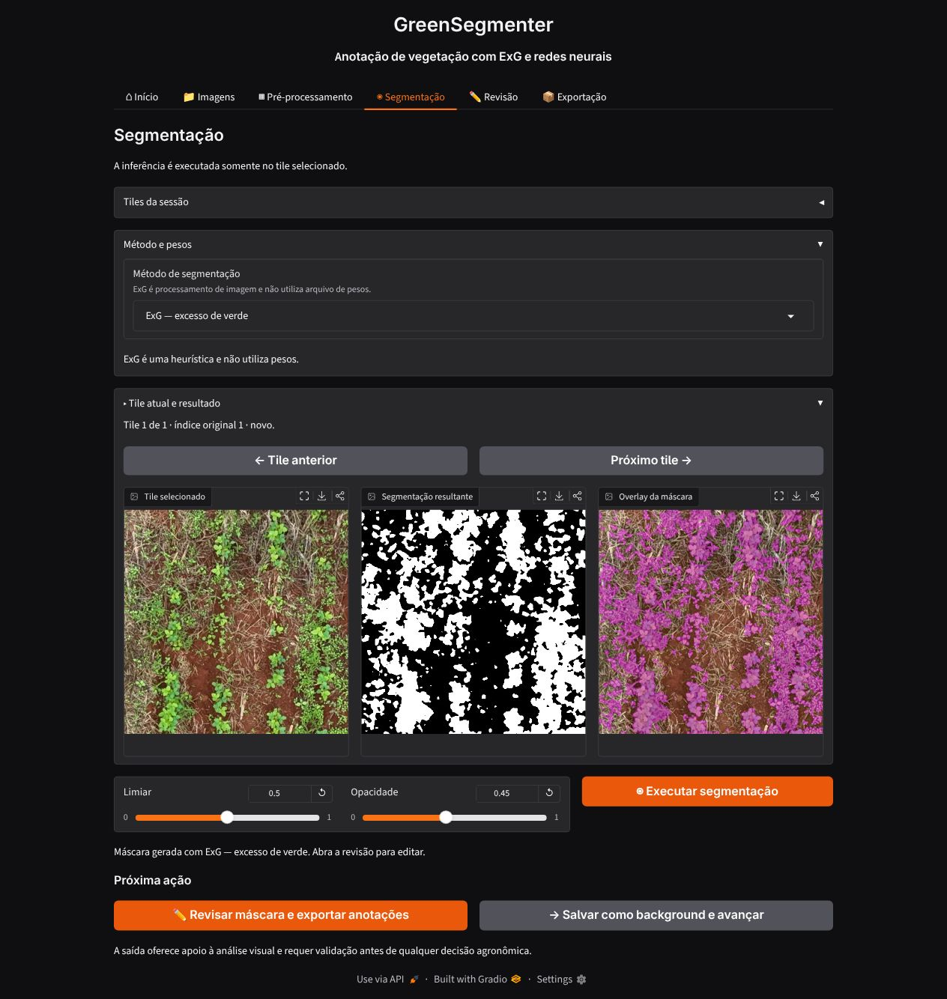
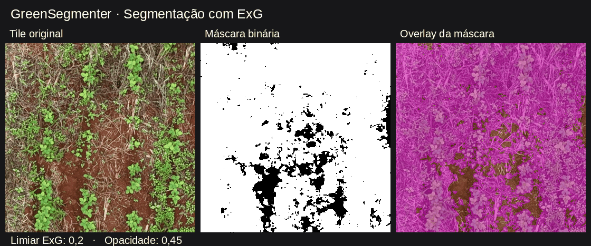
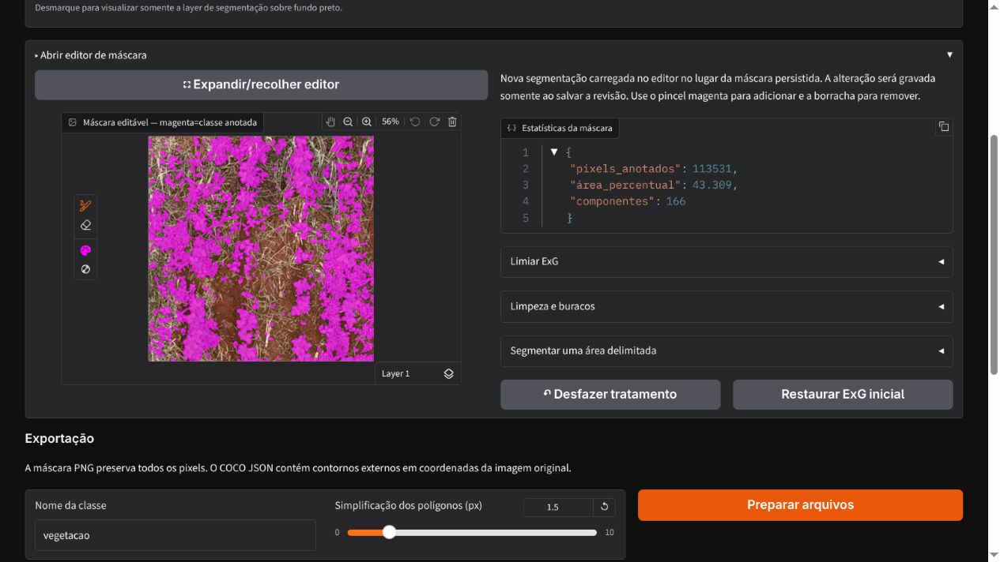
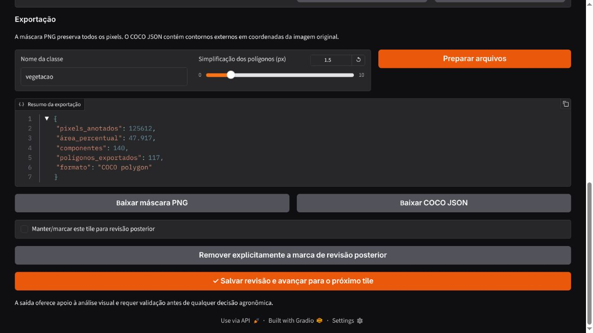

# GreenSegmenter

Aplicação web local para criar e revisar anotações binárias de vegetação com ExG
(excesso de verde) e redes neurais opcionais. Gere uma máscara inicial, corrija
com pincel e borracha e exporte as anotações.

## O aplicativo em imagens

As capturas abaixo usam um único tile de soja de 512 × 512 pixels em todo o
fluxo. A máscara inicial foi gerada pelo **ExG**, com limiar 0,5; o magenta
identifica os pixels selecionados como vegetação.

**1. Gerar a máscara e comparar o resultado.** A seção de segmentação mostra
o tile original, a máscara binária e a sobreposição. Ajuste o limiar para
selecionar o verde e a opacidade para inspecionar a imagem sob a máscara.



O GIF abaixo mostra o mesmo tile com limiares ExG de **0,2 a 0,9**, mantendo
a opacidade do overlay em **0,45**. Os resultados são calculados pelo segmentador
do app, não por uma rede neural. Aumentar o limiar reduz a seleção de vegetação.
Na interface, ajuste o limiar e clique em **Executar segmentação** para recalcular.



**2. Revisar a anotação.** O mesmo tile é aberto no editor com a máscara em
magenta. Use pincel e borracha para corrigir a seleção, ou aplique os tratamentos
de limpeza e segmentação de uma área delimitada.



**3. Exportar os arquivos.** Informe a classe, ajuste a simplificação dos
contornos e clique em **Preparar arquivos** para disponibilizar PNG e COCO JSON.
Use **Salvar revisão e avançar** para persistir a anotação na sessão.



## Executar

Requer Python 3.11 ou superior e [uv](https://docs.astral.sh/uv/).
Na raiz do projeto:

```bash
uv run app.py
```

Abra a URL exibida no terminal. O uv cria e sincroniza o ambiente automaticamente.
Para aplicar mudanças de código, encerre com Ctrl+C e execute novamente.

## Fluxo de anotação

1. **Carregar imagens:** envie PNG, JPEG ou TIFF, uma coleção ou um diretório local.
   Também é possível carregar tiles previamente recortados.
2. **Pré-processamento:** configure tamanho, sobreposição e presença mínima de
   verde. Tiles de borda recebem padding e preservam suas coordenadas válidas.
   O filtro opcional de semelhantes usa SSIM com limiar inicial de 90%.
   Inspecione a galeria e ajuste manualmente a seleção.
3. **Segmentação:** inicie uma sessão, escolha ExG ou modelo neural e ajuste
   o limiar. Compare imagem, máscara e overlay magenta. As setas carregam
   automaticamente as máscaras já existentes.
4. **Revisão:** use pincel magenta e borracha. A edição acontece no navegador.
   Opcionalmente remova componentes pequenos, preencha buracos, aplique
   abertura/fechamento morfológico ou segmente uma região retangular.
   Tratamentos automáticos possuem histórico para desfazer.
5. **Salvar e exportar:** salve cada revisão para persistir e avançar. Marque
   tiles sem vegetação como background ou sinalize revisão posterior.
   Exporte máscaras PNG, COCO JSON e ZIP de anotações e tiles RGB.
   Exportação parcial inclui somente anotações já salvas.

O ExG calcula `2G − R − B` sobre RGB normalizado e converte o índice em um escore
de 0 a 1. Limiar inicial: 0,5. É uma heurística de cor; outros objetos verdes
podem ser selecionados. Revise a máscara antes de usá-la como anotação.

## Redes neurais opcionais

```bash
uv run --extra neural app.py
```

Escolha **Rede neural — TorchScript** e carregue um modelo exportado em `.pt`
ou `.pth`. Nenhum checkpoint é distribuído ou carregado automaticamente.
Arquivos contendo somente `state_dict` não são aceitos: exporte o modelo
completo com `torch.jit.trace` ou `torch.jit.script`.

Contrato do modelo:

- Entrada RGB float32: `1 × 3 × H × W`, valores em `[0,1]`.
- Saída de logits: `1 × 1 × H' × W'` (sigmoid) ou
  `1 × 2 × H' × W'` (softmax; fundo=0, vegetação=1).
- O modelo exportado deve incluir normalização e transformações específicas do
  treinamento, como padding e redimensionamento para tamanhos mínimos.
- A aplicação restaura os logits ao tamanho do tile antes da decisão binária.
- A inferência usa CPU e mantém um modelo carregado em cache.

O protocolo `Segmenter` em `greensegmenter/domain.py` permite integrar outros
mecanismos de inferência que retornem probabilidade por pixel.

## Sessões e exportação

As sessões ficam em `workspace/sessions/<id>/`, contendo manifesto JSON,
imagens-fonte, tiles, máscaras e probabilidades opcionais. Retome pela tela inicial.
Máscaras neurais continuam pendentes até uma pessoa revisar e salvar.

O progresso é salvo a cada revisão, não a cada pincelada. Salve antes de sair.
É possível adicionar amostras, ignorar imagens já usadas pelo hash dos pixels,
reabrir máscaras salvas e excluir fontes/tiles da seleção ativa. Exclusões são
lógicas: os arquivos originais são preservados e os índices permanecem estáveis.
Tiles são carregados sob demanda para reduzir o consumo de memória.

PNG: `0`=fundo e `255`=vegetação. O PNG é a fonte de verdade. COCO contém
contornos externos com simplificação configurável nas coordenadas da imagem-fonte;
buracos e pequenos detalhes podem não estar representados no JSON.

`workspace/`, `models/`, checkpoints, caches, ambientes virtuais, configurações
pessoais e credenciais são ignorados pelo Git. Mantenha backups das sessões
separadamente. As imagens são armazenadas localmente.

## GPU para ExG

Com GPU NVIDIA e CUDA 13 compatível:

```bash
uv run --extra gpu app.py
```

GPU (CuPy) só aparece se CUDA estiver disponível. CPU é o padrão.
Essa opção acelera o ExG; TorchScript permanece em CPU.

## Desenvolvimento

```bash
uv run --extra dev python -m pytest
```

`app.py` contém a interface. `greensegmenter/` contém processamento, inferência,
tiles, anotações, sessões e visualização. `tests/` usa dados determinísticos.
Avaliação supervisionada, análise geométrica e treinamento estão fora do escopo.
